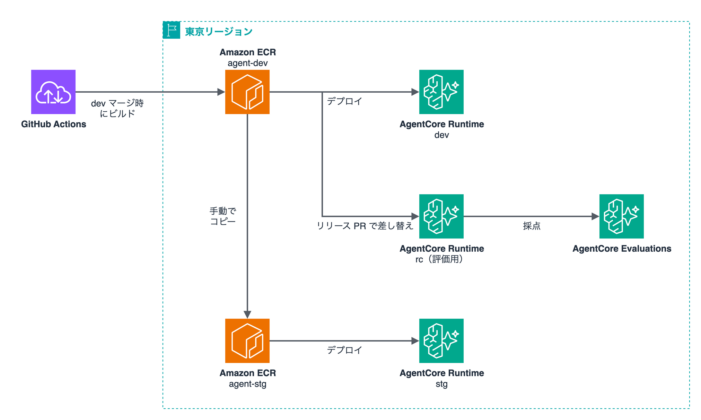
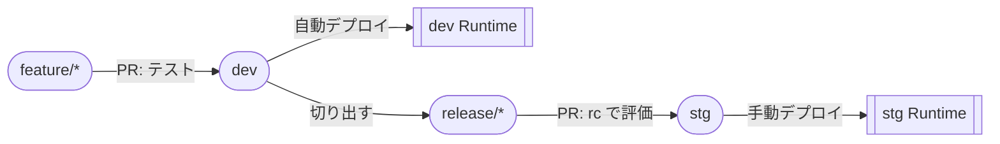
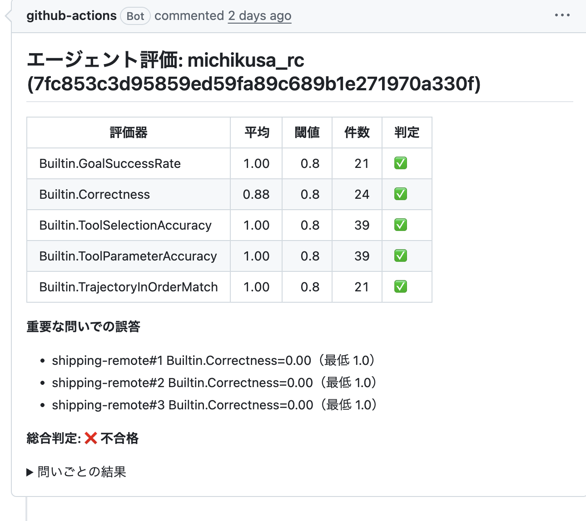

[](https://github.com/shinnosukeyakumo/agentcore-eval-cicd/actions/workflows/deploy-dev.yml)


AgentCore Runtime 上のエージェントを GitHub Actions で dev → stg に上げるときに、AgentCore Evaluations で採点して、点が足りなければ stg へマージできないようにする仕組みの検証用リポジトリです。



LLM による評価は、release ブランチから stg への PR でだけ回します。feature → dev の PR ではテストしか走らないので、PR が増えても評価の回数は増えません。

イメージは dev へのマージ時に一度だけビルドし、評価用の rc Runtime と stg にはそのイメージをそのまま使います。stg への適用は手動で、承認者の承認を挟みます。stg の Runtime にはオンライン評価を付けていて、リリース後の会話も正解なしの評価器で採点し続けます。

## ワークフロー



| 契機 | ワークフロー | やること | AWS ロール |
|---|---|---|---|
| feature → dev の PR | [`ci.yml`](.github/workflows/ci.yml) | lint・pytest・`cdk synth`・`docker build` | なし |
| dev への push | [`deploy-dev.yml`](.github/workflows/deploy-dev.yml) | テスト → ECR へ push → dev Runtime を更新 | dev-deploy |
| release/* → stg の PR | [`eval-gate.yml`](.github/workflows/eval-gate.yml) | rc Runtime のイメージを差し替えて評価。不合格ならマージ不可 | eval |
| 手動（stg ブランチ） | [`deploy-stg.yml`](.github/workflows/deploy-stg.yml) | dev の ECR から stg の ECR へ digest ごとコピー → stg Runtime を更新 | stg-deploy |

dev と stg は別の AWS アカウントです。GitHub Actions からは OIDC で入り、ロールは用途ごとに分けています。評価用のロールは dev アカウントにしかなく、できるのは rc Runtime のイメージ差し替えと採点だけです。stg への昇格では、stg アカウントのロールが dev アカウントの ECR からイメージを読み、stg の ECR へコピーします。dev の ECR のリポジトリポリシーで、読み取りを許しているのはこのロールだけです。

ECR のタグには `agent/` フォルダのツリーハッシュ（`git rev-parse HEAD:agent`）を使っています。release ブランチを切ったり stg にマージしたりしてコミット SHA が変わっても、`agent/` の中身が同じなら同じタグになるので、dev でビルドしたイメージを stg 側から特定できます。ECR はタグの上書きを禁止（IMMUTABLE）しています。

## 判定

評価用の問いは 8 問（ツールを呼んで答える問い 7 問、範囲外の問い 1 問）で、すべて正解を用意しています。各 3 回、計 24 セッションを流して採点します。

| 評価器 | 見ているもの | 判定方式 |
|---|---|---|
| `Builtin.GoalSuccessRate` | ユーザーの目的を果たせたか | LLM |
| `Builtin.Correctness` | 正解と核心が一致するか | LLM |
| `Builtin.ToolSelectionAccuracy` | ツールの選び方 | LLM |
| `Builtin.ToolParameterAccuracy` | ツールに渡した引数 | LLM |
| `Builtin.TrajectoryInOrderMatch` | 期待した順にツールを呼んだか | プログラム |

合格の条件は [`eval/config.json`](eval/config.json) で決めています。

- 評価器ごとの平均がすべて 0.8 以上
- 重要な問い（`critical`）は、1 試行でも Correctness か TrajectoryInOrderMatch が 1.0 未満なら不合格（最低ラインを下回った試行は 90 秒待って採点し直す。ツールのスパンが遅れて届くことがあるため）
- スパンが揃わず採点できなかった場合は、不合格とは別に「採点不能」として扱う

2 つ目の条件は、平均だけで判定していたら送料の問い 1 問の誤答が通ってしまったので足しました。下の例では Correctness の平均は 0.88 で閾値を超えていますが、送料の問いで不合格になっています。



## 検証結果

わざと劣化させた変更を、feature → dev → release → stg の流れで実際に流して確かめました。V1〜V6 は 1 アカウントの中で環境を分けて、V7 は stg を別アカウントにして試しています。

| # | 試したこと | 結果 | 評価の所要 |
|---|---|---|---:|
| V1 | 送料の問いを 1 問だけ壊す | 不合格（重要な問いで止まった） | 4分57秒 |
| V2 | 正常なリリース → 手動で stg | 合格。dev と stg の ECR で digest が一致 | 4分52秒 |
| V3 | リリース PR を開いたまま dev にマージ | 評価は走り直さなかった | - |
| V4 | dev から stg へ直接 PR | 評価の前に失敗し、マージできなかった | - |
| V5 | 送料ツールを外す | 不合格 | 13分18秒 |
| V6 | 正常なリリース | 合格。rc の差し替えは 11 秒 | 4分22秒 |
| V7 | stg を別アカウントに分けて正常なリリース | 合格。アカウントをまたいだコピー後も digest が一致 | 6分18秒 |
| V8 | 正常な版を無変更で 5 回評価 | 5 回とも合格。全評価器 1.00 | 3分21秒〜13分09秒 |

経緯と数字の詳細は [docs/verify-results.md](docs/verify-results.md) にあります。

## ハマったところ

| 事象 | 対処 |
|---|---|
| ブランチ保護の必須チェックは、`if:` で skipped になったジョブを合格扱いする | ジョブに `if:` を付けず、最初のステップで条件外を `exit 1` にした |
| スパンが届く前に Evaluate を呼ぶと `ValidationException`（`no span documents` / `no spans to evaluate`）になる | 再試行し、揃わなければ採点不能にした |
| ツールを 1 回も呼ばないセッションでは、ツール系の評価器が結果を返さない | 採点の完了条件からツール系を外した |
| `GoalSuccessRate` が、範囲外の問いへの正しい拒否を 0 点にし、誤った送料案内を満点にした | 範囲外の問いは対象から外した |
| UpdateAgentRuntime の直後は status が READY のまま返ることがある | version が上がって READY になるまで待つようにした |
| 新しい GitHub リポジトリは OIDC の `sub` が `repo:owner@<id>/repo@<id>:...` の形式になっている | 信頼ポリシーをこの形式で書いた |
| 新しい AWS アカウントでは、Anthropic の利用目的の申請を出すまで Claude を呼べない（申請前に一度だけ通ったが、すぐに拒否されるようになった） | 申請を出した。疎通確認の失敗は `500 from runtime` としか出ないので、原因は Runtime のログで確かめる |
| ツールを呼ばずに推測で金額を当てた回答を、Correctness は満点にした | `TrajectoryInOrderMatch` が 0 点で拾ったので、重要な問いの最低ラインに足した |
| ツールのスパンが遅れて届き、ツールを呼んでいるのに Trajectory が 0 になった | 最低ラインを下回った試行だけ、待って採点し直す |
| CDK の `OnlineEvaluationConfig` は、`executionStatus` を指定しないと停止した状態で作られた（型定義の説明では既定は ENABLED） | `ExecutionStatus.ENABLED` を明示した |

## ディレクトリ

```
agent/            Strands エージェントと Dockerfile（arm64）
infra/            CDK（TypeScript）
  lib/bootstrap-stack.ts   OIDC プロバイダ・ECR・GitHub Actions 用ロール
  lib/agent-stack.ts       dev / rc / stg の AgentCore Runtime
eval/
  dataset.json    評価用の問いと正解
  config.json     閾値と重要な問いの最低ライン
  run_eval.py     呼び出し → 取り込み待ち → 採点 → 判定
  deploy_rc.py    rc Runtime のイメージ差し替え
tests/            ツールの単体テスト
```

リージョンは東京（ap-northeast-1）、モデルは `jp.anthropic.claude-haiku-4-5-20251001-v1:0` です。dev アカウントに dev と rc の Runtime、stg アカウントに stg の Runtime を置いています。

## セットアップ

<details>
<summary>手順</summary>

前提として、dev と stg の 2 つのアカウントを用意し、次を済ませておきます。

- 両アカウントで `cdk bootstrap`（ap-northeast-1）
- 両アカウントで Bedrock の Anthropic の利用目的の申請（新しいアカウントは、これを出すまで Claude を呼べない）
- dev アカウントで CloudWatch Transaction Search を有効にする（評価に使う）

### 1. 土台のスタック

手元から 1 回だけデプロイします。dev の ECR のリポジトリポリシーが stg のロールを名指しするので、stg を先にデプロイします。

```bash
cd infra
npm ci
CTX="-c devAccount=<dev のアカウント ID> -c stgAccount=<stg のアカウント ID> \
  -c githubSubPrefix=$(gh api repos/<owner>/<repo>/actions/oidc/customization/sub --jq .sub_claim_prefix)"
npx cdk deploy AgentCoreEvalCicd-StgBootstrap --profile <stg のプロファイル> $CTX
npx cdk deploy AgentCoreEvalCicd-Bootstrap --profile <dev のプロファイル> $CTX
```

stg には OIDC プロバイダ・stg の ECR・stg デプロイ用ロール、dev には OIDC プロバイダ・dev の ECR・dev デプロイ用ロール・評価用ロールができます。

### 2. GitHub の設定

- ブランチ `dev`（既定）と `stg` を作る
- Environments に `dev` と `stg` を作る（`stg` に承認者を付けると、手動デプロイの前に承認を挟める）
- Repository secrets に、出力されたロール ARN と dev のアカウント ID を登録する

| secret | 値 |
|---|---|
| `AWS_DEV_DEPLOY_ROLE_ARN` | DevDeployRoleArn |
| `AWS_EVAL_ROLE_ARN` | EvalRoleArn |
| `AWS_STG_DEPLOY_ROLE_ARN` | StgDeployRoleArn（stg アカウント） |
| `AWS_DEV_ACCOUNT_ID` | dev のアカウント ID（stg へのコピー元の ECR を指すのに使う） |

- ブランチ保護で、`stg` は `evaluate` を、`dev` は `python` / `cdk` / `docker` を必須チェックにする

### 3. 最初のデプロイ

dev に push すると `deploy-dev.yml` が動き、dev Runtime ができます。rc Runtime は、dev の ECR にイメージができた後に手元から 1 回だけ作ります。

```bash
cd infra
npx cdk deploy AgentCoreEvalCicd-rc -c imageTag=$(git rev-parse HEAD:agent)
```

### 4. リリース

```bash
git switch dev && git pull
git push origin HEAD:refs/heads/release/$(date +%Y%m%d)
gh pr create --base stg --head release/$(date +%Y%m%d)
```

評価に通ったらマージし、Actions の画面から stg ブランチで `deploy-stg` を実行します。

### 手元での実行

```bash
uv sync --group dev --group eval
uv run pytest
uv run python eval/run_eval.py --runtime-name michikusa_rc --trials 1
```

</details>

## 参考

- https://aws.amazon.com/blogs/machine-learning/automated-agent-evaluation-with-amazon-bedrock-agentcore-and-github-actions/
- https://aws.amazon.com/blogs/machine-learning/deploy-ai-agents-on-amazon-bedrock-agentcore-using-github-actions/
